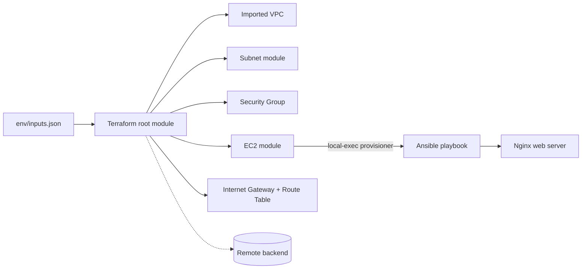

# AWS Infrastructure Deployment with Terraform and Ansible

Infrastructure as Code project that builds AWS networking and compute resources with Terraform, using reusable modules and environment-based configuration, then configures the servers automatically with Ansible.

## Overview

- Imports an existing AWS VPC into Terraform and protects it from accidental deletion.
- Creates subnets, an internet gateway, route tables, and a security group.
- Launches EC2 instances through a reusable module.
- Switches settings between `prod` and `non-prod` using a single JSON file (instance type, instance count, allowed ports).
- Configures each new instance with an Ansible playbook that installs and starts Nginx, triggered automatically from Terraform.

## Architecture




## Tech Stack

| Area | Tools |
|---|---|
| Cloud | AWS (VPC, Subnets, EC2, Security Groups, Internet Gateway, Route Tables) |
| Infrastructure as Code | Terraform (modules, data sources, locals, remote backend) |
| Configuration Management | Ansible |
| Web Server | Nginx |

## Repository Structure

```
.
├── ansible/
│   └── playbook.yml        # Installs and starts Nginx on the "web" host group
├── env/
│   └── inputs.json         # Environment settings (prod / non-prod)
├── modules/
│   ├── ec2/         # EC2 instances + Ansible provisioner
│   └── subnet/      # Subnets
├── backend.tf              # Remote state configuration
├── data.tf                 # Data sources (AMI lookup)
├── internetGW.tf           # Internet gateway
├── locals.tf               # Environment-based values and common tags
├── main.tf                 # Module calls
├── outputs.tf
├── provider.tf
├── route-association.tf
├── route-table.tf
├── sg.tf                   # Security group
├── variables.tf
└── vpc.tf                  # Imported VPC
```

## Environment Configuration

Settings are controlled from `env/inputs.json`:

| Setting | non-prod | prod |
|---|---|---|
| Instance type | `t3.micro` | `t3.medium` |
| Allowed ports | 22, 80 | 22, 443 |

The environment name, region, project name, owner, and base instance count are set in the same file.

## Getting Started

### Prerequisites
- AWS account and credentials configured with the AWS CLI
- Terraform, Ansible, and `nc` (netcat) installed on the machine running Terraform
- An EC2 key pair created in AWS, with the private key saved locally
- Remote backend resources (for example an S3 bucket) created beforehand

### Deploy

```bash
# 1. Initialize providers, modules, and the backend
terraform init

# 2. Import the existing VPC into the state (first run only)
terraform import aws_vpc.imported_vpc <your-vpc-id>

# 3. Review and apply
terraform plan
terraform apply
```

After the apply finishes, Terraform waits for SSH on each instance and runs the Ansible playbook automatically.

### Verify

```bash
curl http://<instance-public-ip>
```

The page should return the message from the playbook (the `non-prod` security group allows port 80).
